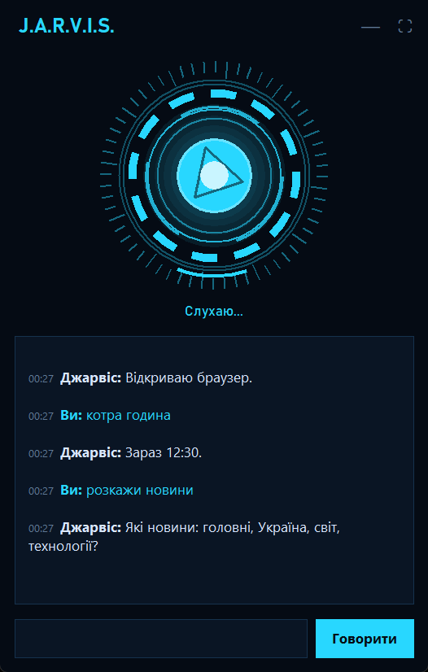
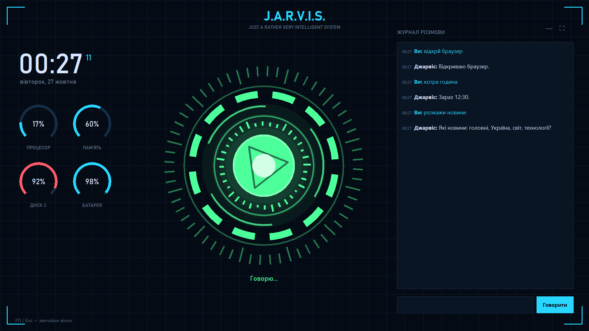
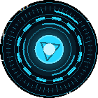

# Джарвіс

**Версія 2.1** — що нового, дивіться в [CHANGELOG.md](CHANGELOG.md).

| Звичайне вікно | На весь екран | Міні-реактор |
|---|---|---|
|  |  |  |

Голосовий асистент для Windows. Прості команди виконує сам, без інтернету. Для роботи з кодом відкриває Claude Code і повідомляє, коли Claude закінчив.

**Платний Claude API не використовується.** Claude Code працює за вашою звичайною підпискою Claude. Для запитів, які Джарвіс не розуміє сам, можна підключити безкоштовну локальну модель (Ollama).

## Як він думає

```
мікрофон ─► офлайн-розпізнавання (Vosk) ─► «Джарвіс» у фразі?
                                              │
          ┌───────────────────────────────────┤
          ▼                                   ▼
  активний режим?                  вбудована команда?  ── так ─► виконує сам (без інтернету)
  (диктування для Claude Code)                │ ні
                                              ▼
                              точніше розпізнавання (Google, безкоштовно, якщо є інтернет)
                                              ▼
                              локальна модель (Ollama), якщо встановлена
                                              ▼
                              голос: edge-tts (онлайн) / Piper (офлайн)

Claude Code ──(хуки: «закінчив», «потрібен дозвіл»)──► сервер подій Джарвіса ──► голосом вам
```

## Встановлення

1. Залежності вже стоять у `.venv`. Встановити заново: `python -m venv .venv` і `.venv\Scripts\pip install -r requirements.txt`
2. Офлайн-моделі мовлення: `.venv\Scripts\python scripts\setup_models.py` (~500 МБ, лягають у `%LOCALAPPDATA%\Jarvis\models`)
3. *(Необов'язково)* Локальна ШІ: встановіть [Ollama](https://ollama.com) і виконайте `ollama pull qwen3:4b`. Тоді Джарвіс зможе розмовляти й розуміти довільні фрази, офлайн і безкоштовно.

## Запуск

- **Ctrl+Alt+J** у будь-якому місці Windows запускає Джарвіса без вікна консолі. Якщо він уже працює, ця комбінація показує його вікно й вмикає слухання. Ярлик лежить у меню Пуск («Jarvis»); створити заново або змінити клавішу: `.venv\Scripts\python scripts\setup_shortcut.py "Ctrl+Alt+J"`. Журнал: `%LOCALAPPDATA%\Jarvis\jarvis.log`.
- `jarvis.bat` — вікно + голос + консоль із журналом
- `jarvis.bat --console` — без вікна, лише консоль
- `jarvis.bat --text` — без мікрофона, команди з клавіатури в консолі
- `jarvis.bat --list-mics` — список мікрофонів (номер можна вписати в `settings.json` → `mic_index`)

## Як змусити його слухати

Джарвіс **не реагує, поки ви не натиснете `-` і `=` одночасно** (або кнопку «Говорити» у вікні). Після натискання звучить високий сигнал, і в нього є 8 секунд, щоб почути команду. Слово «Джарвіс» казати не треба. Після відповіді він ще 8 секунд чекає наступну команду, потім лунає низький сигнал: більше не слухає. Повторне натискання скасовує слухання.

У режимі диктування й коли Claude Code просить дозволу Джарвіс слухає без натискань.

Змінити комбінацію: `settings.json` → `hotkey` (напр. `"ctrl+alt+j"`, `"f9"`). Щоб він слухав завжди й чекав слова «Джарвіс»: `"activation": "wake_word"`.

## Вікно

Вікно з'являється одразу після запуску (поки вантажаться моделі, реактор показує «Завантажуюсь...»).

Індикатор-«реактор» показує стан анімацією: тьмяний — не слухає, блакитний зі сканером — слухає, жовтий — виконує, зелений з «еквалайзером» — говорить. Нижче журнал розмови. Внизу поле, щоб писати команди текстом (Enter), і кнопка «Говорити».

Три вигляди:
- **звичайне вікно**;
- **на весь екран** — кнопка ⛶, F11, подвійний клік по реактору або «Джарвіс, розгорнись». Великий реактор, годинник, завантаження процесора, пам'ять, диск і батарея, журнал. Вийти — Esc / F11 або «Джарвіс, звичайний режим»;
- **міні-реактор** — коли вікно згорнуте (кнопка —, «_» або «Джарвіс, згорнись»), у кутку екрана лишається маленький анімований реактор поверх усіх вікон. Клік — розгорнути, перетягнути — перемістити (місце запам'ятовується), права кнопка — меню.

Набрані чи почуті команди з одруківками Джарвіс теж розуміє: «відкрй браузер», «котра годна», «открой блокнот» (суржик), «dslrhbq ,kjryjn» (набрано в англійській розкладці) — у журналі видно, як він зрозумів фразу. Назви й тексти всередині команди («запиши нотатку …») він не виправляє.

## Команди

| Що сказати | Що станеться |
|---|---|
| Джарвіс, відкрий Claude Code · ...в проєкті my-site | відкриє Claude Code у проєкті й скаже «готовий до роботи» |
| Джарвіс, диктую | режим диктування завдання для Claude Code |
| Джарвіс, відкрий програму Telegram · відкрий додаток VS Code · запусти Steam | шукає програму **на комп'ютері** |
| Джарвіс, відкрий DuckDuckGo · відкрий розетку · знайди рецепт борщу | просто «відкрий / знайди» — **в інтернеті** (крім блокнота, калькулятора та інших вбудованих програм Windows) |
| Джарвіс, відкрий Claude Code (спитає: який проєкт, «останній» чи «новий») · створи новий проєкт | Claude Code в обраному проєкті |
| Джарвіс, знайди файл … · видали файл … · видали програму … | файли й програми: спершу розповість, що знайшов і як видалятиме, і лише після «так» видалить (файли — у Кошик, програми — їхнім деінсталятором) |
| Джарвіс, закрий хром · закрий вікно · закрий вкладку | закриє |
| Джарвіс, згорни все · розгорни · переключи вікно | керування вікнами |
| Джарвіс, гучніше · тихіше на 20 · гучність 30 · вимкни звук | звук |
| Джарвіс, пауза · наступний трек · попередній | музика й відео |
| Джарвіс, запитай у Клода · запитай у Клода як … | новий чат у десктопному Claude (питання вставить, не відправить) |
| Джарвіс, відкрий інтернет / гугл / браузер · зміни пошуковик | обраний пошуковик (першого разу спитає: Google чи DuckDuckGo) |
| Джарвіс, відкрий ютуб · знайди котиків на ютубі · знайди рецепт борщу | інтернет |
| відкрий DuckDuckGo · відкрий сайт розетка | будь-який сайт: якщо такої програми немає, відкриє сайт |
| напиши в гуглі … · введи в адресний рядок … | адресний рядок браузера + Enter |
| нова вкладка · закрий вкладку · закрий вкладку ютуб · перейди на вкладку гітхаб · третя вкладка · поверни закриту вкладку | вкладки (і за назвою) |
| на головну · назад · вперед · онови · спустись нижче · підніми вище · в низ сторінки · на самий верх · знайди на сторінці … · збільш / зменш масштаб | перегляд («сторінка» = «вкладка»: наступна сторінка, закрий сторінку) |
| запусти відео · постав відео на паузу · перемотай вперед / назад · відео на весь екран · вимкни звук на відео · увімкни субтитри | відео (на YouTube — повне керування) |
| новини (спитає яку тему) · новини технологій / спорту / світу · новини про SpaceX · ще · відкрий другу новину | новини (Google Новини, технології — AIN.ua) |
| напиши варіанти · запропонуй ідеї для проєкту · ще · запиши другу ідею | ідеї для проєктів |
| говори швидше · говори повільніше | швидкість голосу |
| зайди до Максима в чат · відкрий чат з Максимом · зайди в другий чат · відкрий збережене · наступний чат · закрий чат | Telegram |
| запиши цілі (далі по одній, наприкінці «все») · запиши ціль … · розкажи цілі на сьогодні · виконав другу ціль · очисти цілі | цілі на день |
| запиши нотатку … · прочитай нотатки · відкрий нотатки / цілі | нотатки (файли в `%LOCALAPPDATA%\Jarvis\notes`) |
| напиши привіт · напиши привіт і відправ · відправ | друк у вікні, з яким ви працюєте (у месенджерах спитає, чи відправити) |
| Джарвіс, відкрий останній проєкт · відкрий проєкт my-site · які в мене проєкти | проєкти у VS Code |
| Джарвіс, відкрий завантаження / документи / кошик | папки |
| Джарвіс, котра година · яке сьогодні число · стан системи | інформація |
| Джарвіс, зроби скріншот · надрукуй ... · натисни ентер · натисни альт таб · контрол шифт ескейп · альт ф4 · скопіюй · збережи | клавіатура й екран (будь-які комбінації клавіш) |
| Джарвіс, заблокуй / вимкни / перезавантаж комп'ютер | живлення (з підтвердженням) |
| Джарвіс, яка модель · нова розмова · повтори · що ти вмієш · до побачення / закрийся / вимкни Джарвіса | керування Джарвісом |
| Джарвіс, розгорнись · згорнись / сховайся · звичайний режим | вікно Джарвіса: на весь екран, міні-реактор, звичайне |

## Claude Code

1. **«Джарвіс, відкрий Claude Code»** відкриває вікно з Claude Code в останньому проєкті (або «...в проєкті my-site»). Джарвіс каже: «Claude Code готовий до роботи».
2. Далі ви працюєте в Claude Code самі, як звичайно.
3. Коли Claude закінчить, Джарвіс скаже «Claude Code закінчив роботу» і коротко перекаже відповідь.
4. Якщо Claude просить дозволу на дію, Джарвіс спитає голосом. Відповідайте «дозволяю» або «ні», або натисніть самі.

**Диктування (за бажанням):** «Джарвіс, диктую» → говоріть завдання. Джарвіс зачитує, що записав. Скажіть «відправ», і завдання піде в Claude Code. Також працюють «прочитай», «видали останнє», «очисти», «прочитай відповідь», «вийди з режиму».

Якщо Claude Code вперше відкривають у папці, він питає, чи довіряєте ви їй. Підтвердіть.

## Безпека й приватність

- **Ключів і паролів у коді немає.** Claude Code і десктопний Claude працюють за обліковим записом того, хто ними користується на своєму комп'ютері. Завантаживши Джарвіса, людина не отримує доступу до чужої підписки.
- **Особисті дані не потрапляють у репозиторій:** налаштування, цілі, нотатки, журнал і моделі лежать у `%LOCALAPPDATA%\Jarvis` на вашому комп'ютері.
- **Сервер подій** (`127.0.0.1:8765`) доступний лише з цього комп'ютера. Він приймає тільки JSON без заголовка `Origin`, тобто не з веб-сторінок, і лише дозволені події: «Claude Code закінчив», «показати вікно». Виконати через нього довільну команду не можна.
- Вимкнення ПК, видалення файлів і програм, команди PowerShell і відправлення повідомлень у месенджерах — лише після вашого «так». Перед видаленням Джарвіс розповідає, що саме знайшов і як видалятиме.

## Налаштування

Файл `%LOCALAPPDATA%\Jarvis\settings.json` (шлях виводиться при запуску):
- `local_model`: модель в Ollama (за замовчуванням `qwen3:4b`)
- `tts_engine`: `auto` | `edge` | `piper`; `edge_voice`; `piper_speaker` (0 Лада, 1 Микита, 2 Тетяна)
- `speech_speed`: швидкість голосу у відсотках (0 — звичайна, 25 — за замовчуванням)
- `activation`: `hotkey` | `wake_word`; `hotkey`; `listen_seconds`; `followup_seconds`
- `pause_seconds`: скільки секунд тиші означає кінець фрази (більше — не перебиває на паузах)
- `browser`: `chrome` | `default` | шлях до .exe; `search_engine`: `google` | `duckduckgo` (порожньо — спитає)
- `projects_dir`: де створювати нові проєкти (порожньо — поруч із папкою Джарвіса)
- `wake_words`, `mic_index`
- `claude_code_summary`: чи переказувати відповідь Claude Code
- `projects`: власні назви проєктів, напр. `{"сайт": "C:/Projects/my-site"}`
- `apps`: власні назви програм, напр. `{"гра": "C:/Games/game.exe"}`
- `window_mode`: яким показувати вікно при запуску — `normal` | `full` | `mini`; `mini_position`: де стоїть міні-реактор

Короткі фрази Джарвіса кешуються в `%LOCALAPPDATA%\Jarvis\tts_cache` — повторні відповіді звучать миттєво й без інтернету.

## Структура

```
main.py                  точка входу (на нього вказує ярлик Ctrl+Alt+J)
scripts/
  setup_models.py        завантаження офлайн-моделей
  setup_shortcut.py      ярлик у меню Пуск із гарячою клавішею запуску
tests/                   тести: яку команду Джарвіс вибере на фразу (нічого не виконують)
docs/screenshots/        знімки вікна для README
jarvis/
  core/
    assistant.py         головний цикл: режим → вбудована команда → локальна модель
    registry.py          реєстр навичок (@command, @tool)
    runtime.py           доступ до асистента з навичок (say, listen, confirm, події)
    events.py            локальний сервер подій (127.0.0.1:8765) для Claude Code та інших програм
    text.py              нормалізація, числа словами, транслітерація, одруківки, розкладка
    desktop.py           вікна, клавіші, буфер обміну
  voice/stt.py           вуха: Vosk (офлайн) + Google (точно, онлайн)
  voice/tts.py           голос: edge-tts (онлайн) / Piper (офлайн)
  ui/hud.py              вікно (tkinter): звичайне, на весь екран, міні-реактор; ui/console.py — консоль
  brains/local.py        локальна модель через Ollama
  skills/                навички: apps, web, media, keyboard, system, screen, files, projects, claude_code,
                         claude_chat, telegram, notes, news, ideas, control
  hooks/                 хук, яким Claude Code повідомляє Джарвіса
```

## Як додати нову навичку

Створіть файл у `jarvis/skills/`, він підключиться автоматично:

```python
from jarvis.core.registry import command, tool

@tool
def weather(city: str) -> str:
    """Погода в місті (цей опис бачить локальна модель).

    Args:
        city: Назва міста.
    """
    return "Сонячно, +20."

@command(r"яка погода(?: в (?P<city>.+))?", priority=3)   # фраза, яку Джарвіс виконує сам
def _weather(city="Київ"):
    return weather(city)
```

`@command` — фраза, яку Джарвіс виконує сам. Шаблон перевіряється на нормалізованому тексті: нижній регістр, без розділових знаків. `@tool` — та сама дія для локальної моделі.

Інші програми можуть надсилати Джарвісу події: `POST http://127.0.0.1:8765/event` з `{"type": "...", "payload": {...}}`. Обробник реєструється через `@runtime.on_event("тип")`.

## Розробка

Гілки:
- `main` — стабільні версії. Кожна версія має тег (`v2.0`, `v2.1`, ...) і запис у [CHANGELOG.md](CHANGELOG.md).
- `dev` — поточна розробка. Нові можливості спершу потрапляють сюди.
- `feature/<назва>` — окрема гілка для кожної великої можливості (напр. `feature/weather`), відгалужується від `dev` і зливається назад у `dev`, коли готова.

Випуск версії: `dev` → `main`, запис у CHANGELOG, тег.

Тести (перевіряють, яку команду Джарвіс вибере на фразу; нічого не відкривають і не натискають):

```
.venv\Scripts\pip install -r requirements-dev.txt
.venv\Scripts\python -m pytest
```
